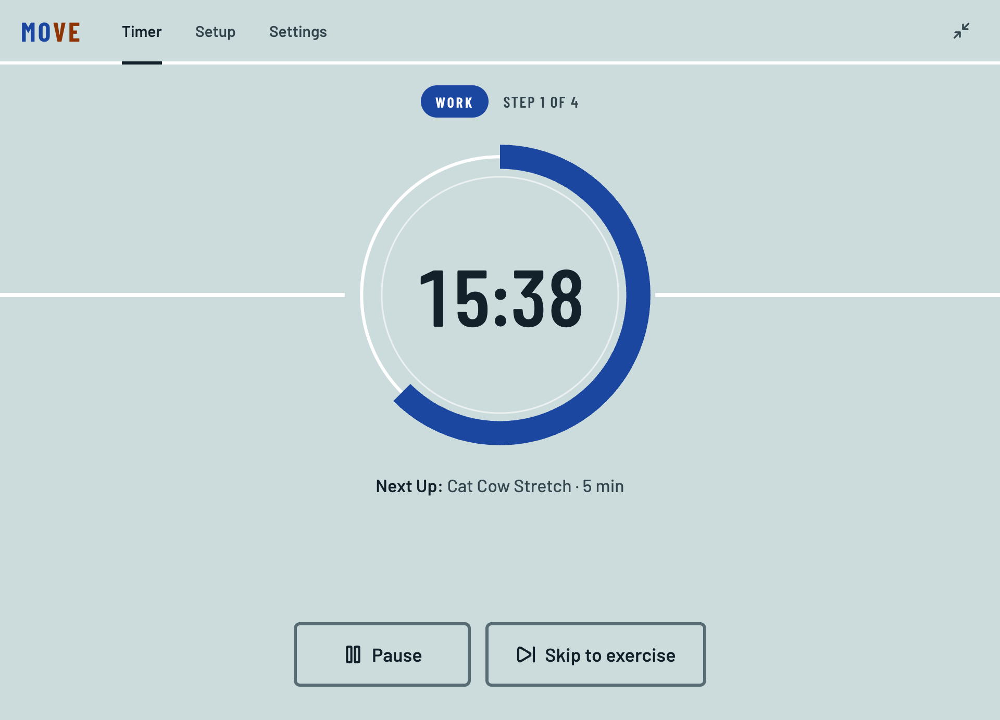
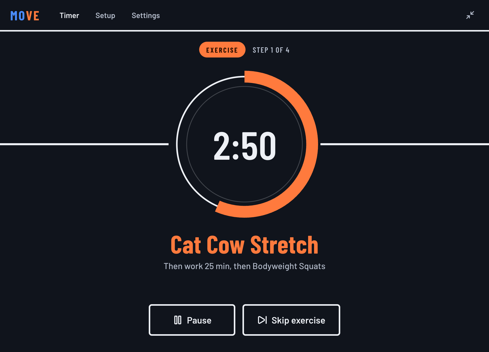
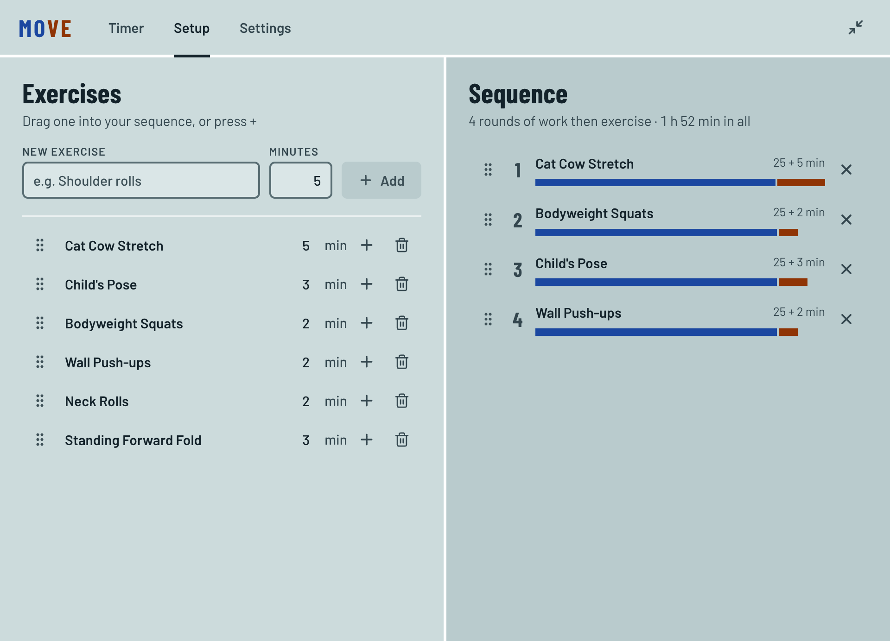
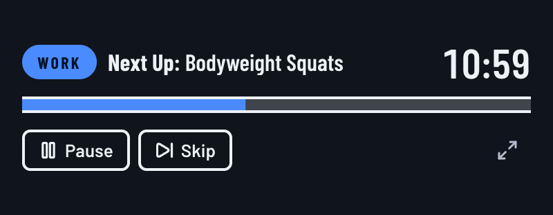
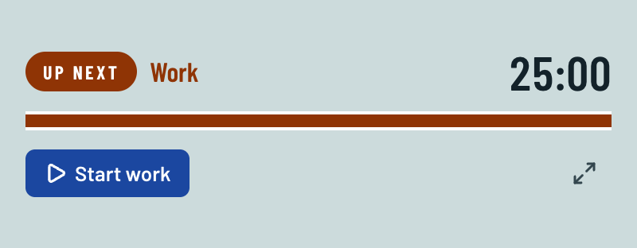

# MOVE

A pomodoro timer where every break is an exercise. Build a list of exercises, arrange them into a sequence, and MOVE alternates a work period with the next exercise.

Download the Mac, Windows or Linux installer from [Releases](https://github.com/makahn64/move_pomodoro_timer/releases).

| Work | Exercise |
| --- | --- |
|  |  |

**Setup:** drag exercises from your list into the sequence. Each bar shows that round's work and exercise time.



**Mini window:** a small timer that stays out of the way while you work.




- Spec and design decisions: [docs/MOVE-app-spec.md](docs/MOVE-app-spec.md)
- Installing for non-technical users: [INSTALL.md](INSTALL.md)

## Development

```bash
npm install
npm run dev        # run with hot reload
npm test           # session state machine tests
npm run lint
npm run typecheck
```

## Building installers

Unsigned installers go to `dist/`:

```bash
npm run build:mac    # MOVE-<version>.dmg (universal, ad-hoc signed)
npm run build:win    # MOVE-<version>-setup.exe
npm run build:linux  # MOVE-<version>.AppImage
```

All three can be built from a Mac.

## Layout

- `src/main`: Electron main process (window sizing, bring-to-front, saving data as JSON in the user data folder)
- `src/preload`: the `window.api` bridge
- `src/shared`: types and first-run defaults
- `src/renderer/src/session.ts`: the timer as a pure state machine (tested in `session.test.ts`)
- `src/renderer/src/sounds.ts`: the two boundary sounds, synthesized with Web Audio
- `src/renderer/src/components`: Timer, Mini, Setup and Settings views
